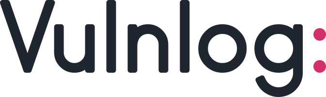

= Vulnlog Brand
:toc:
:toclevels: 2

This document defines the Vulnlog identity: the name, the logo, the colours and the type.
It holds the rules and the exact values.
To see how it all looks, open link:../assets/brand/brand-board.html[the brand board] in a browser.

Vulnlog is an open source project, so the rules are few.
When a case isn't covered here, choose the calmer and simpler option.

== Character

Vulnlog should feel well engineered, clever and elegant, and never cheap.
It is welcoming to developers, security engineers, and the people who only read its reports.

Most security tools look dark and alarming.
Vulnlog is the opposite: a calm place where a team records what it has decided.
The design follows from that.

* Light surfaces and a lot of white space.
* One brand colour, used sparingly.
* Flat shapes, with no gradients and no shadows.
* Plain words, with no fear and no marketing claims.

== Name

Write *Vulnlog*, with a capital V and nothing else in capitals.

* Not VulnLog, and not VULNLOG.
* Write `vulnlog` in lower case only where it is code: the command, a package, a file name.
* The colon is part of the logo.
Don't type "Vulnlog:" in running text or headings.

Vulnlog has no tagline.
Where one line has to describe it, use the description from the documentation start page:

____
Vulnlog is a YAML format and a CLI for recording how vulnerabilities affect your software, and for generating suppression files, reports, and OpenVEX documents.
____

== Logo

The logo is the name followed by a raspberry colon.
The colon turns the name into a key, as in a YAML file: the name waits for your answer.

The letters are drawn for Vulnlog and aren't a font.
They are built from a single line with flat ends and slightly softened corners.
The colon is the only fully round shape and the only coloured one.

=== Files

All files are in `assets/brand/`.

[cols="2,3"]
|===
|File |Use

|`vulnlog-logo.svg`
|Light backgrounds. Ink letters, raspberry colon.

|`vulnlog-logo-dark.svg`
|Dark backgrounds. Chalk letters, raspberry colon.

|`vulnlog-logo-mono.svg`
|One colour only, for print, engraving or a coloured background. Takes the surrounding text colour.

|`vulnlog-mark.svg`
|The V and the colon on a raspberry tile. Favicon, app icon, small spaces.

|`vulnlog-mark-round.svg`
|The same on a circle, for avatars that are cropped round.
|===

=== Rules

* Keep clear space around the logo equal to the height of its letter "o".
* Don't show the logo narrower than 80 pixels.
Below that, use the mark.
* Don't show the mark smaller than 16 pixels.
* On raspberry, use the one-colour logo in white.
* Don't change the colour of the colon, and don't remove it.
* Don't stretch, rotate, outline or shade the logo.
* Don't set a line of text under the logo as part of it.
* Don't rebuild the logo in a font.

=== Mascot

Vulnlog has no mascot.
The logo doesn't depend on one, so a character can join later for documentation and stickers without changing anything here.

== Colour

Raspberry is the only brand colour.
Every coloured value below is the same in the light and the dark theme.
Only the neutrals change with the theme.
Neither theme uses pure white or pure black.

The contrast columns give the WCAG contrast ratio against Paper and against Night.
Shapes and large text need 3.0, small text needs 4.5.

=== Brand

[cols="2,2,1,1,4"]
|===
|Name |Value |Paper |Night |Use

|Raspberry
|`#d32f6a`
|4.6
|3.6
|The colon, primary buttons, links, focus rings.
|===

* Text on raspberry is white, `#ffffff`, at a contrast of 4.8.
* Underline links.
On Night, raspberry is below 4.5 for small text, so a link must not rely on colour alone.
* Don't use raspberry for decoration, for large filled areas or for a severity.

=== Neutrals

[cols="2,2,2,2,4"]
|===
|Role |Light name |Light value |Dark value |Dark name

|Page
|Paper
|`#fafbfc`
|`#161b22`
|Night

|Panels and code blocks
|Mist
|`#f1f3f5`
|`#1e242c`
|Dusk

|Borders
|Line
|`#d9dee3`
|`#313943`
|Night line

|Text and logo letters
|Ink
|`#1f2630`
|`#e3e8ee`
|Chalk

|Secondary text
|Ink soft
|`#59636e`
|`#9aa5b1`
|Chalk soft
|===

Text reaches a contrast of 14.7 in the light theme and 14.0 in the dark theme.
Secondary text reaches 5.9 and 6.9.

=== Findings

These colours mean a severity or a status, and nothing else.
They keep the hues people expect.

[cols="2,2,1,1,4"]
|===
|Name |Value |Paper |Night |Meaning

|Critical
|`#d63a24`
|4.5
|3.7
|Severity critical

|High
|`#d97a0a`
|3.0
|5.6
|Severity high

|Medium
|`#c9a00d`
|2.4
|7.0
|Severity medium

|Low
|`#3b7fc4`
|4.0
|4.1
|Severity low

|Fixed
|`#3f9a63`
|3.4
|5.0
|Resolved, positive

|Accepted
|`#7f79b8`
|3.8
|4.4
|Risk accepted

|Muted
|`#7f8a94`
|3.4
|4.9
|No severity, not relevant
|===

* Always write the severity or status next to its colour.
Medium can't reach 3.0 on a light background, so the colour alone isn't enough.
* Use them as stripes, dots and chart marks, not as text colours.

=== Diagrams

Diagrams start in neutrals.
Add colour only to tell things apart, in this order.

[cols="2,2,1,1,4"]
|===
|Name |Value |Paper |Night |Use

|Raspberry
|`#d32f6a`
|4.6
|3.6
|The subject of the diagram, usually Vulnlog itself

|Petrol
|`#1f8a96`
|3.9
|4.2
|Second series

|Indigo
|`#6c7fd1`
|3.6
|4.6
|Third series

|Moss
|`#6a9a3f`
|3.2
|5.2
|Fourth series

|Slate
|`#7f8a94`
|3.4
|4.9
|Context and anything secondary
|===

* Label shapes directly, so nobody has to match colours to a legend.
* When a diagram shows severities or statuses, use the finding colours for them.

== Type

[cols="2,3,4"]
|===
|Where |Typeface |Notes

|Website and documentation
|Figtree, in weights 400, 600 and 700
|Open source. Load it from `fonts.bunny.net`.

|Code, commands, file names
|JetBrains Mono, in weights 400 and 500
|Open source. Load it from `fonts.bunny.net`.

|HTML report
|The reader's system font
|The report must work without a network connection, so it loads no fonts.
|===

* Body text is 16 pixels with a line height of 1.55.
* Headings are weight 700, with slightly tight letter spacing.
* Keep lines of running text to about 65 characters.
* Fall back to `system-ui` and `ui-monospace` when a font can't load.

== Shapes

* Corners have a radius of 6 pixels.
* Borders are 1 pixel in the Line colour.
* No shadows and no gradients.
* A primary button is raspberry with white text.
A page has one primary action at most.

== Where the brand appears

[cols="2,5"]
|===
|Place |What to use

|Website and documentation
|The logo in the header, the full palette, Figtree and JetBrains Mono.

|HTML report
|The report belongs to the team that generates it.
It carries the finding colours and a small mark with "Generated by Vulnlog" in the footer, and nothing else of the brand.

|GitHub, package registries, social accounts
|The mark as the avatar, round where the platform crops it.

|Favicon
|The mark.

|Command line
|No logo and no brand colour.
Colour in terminal output is reserved for severities and errors.

|Slides and stickers
|The logo or the mark on Paper, Night or raspberry.
|===

== Voice

* Say what Vulnlog does in plain words.
* Don't frighten the reader, and don't promise security.
* Say what Vulnlog doesn't do: it doesn't scan and it doesn't analyse.
* Address the reader as "you".
